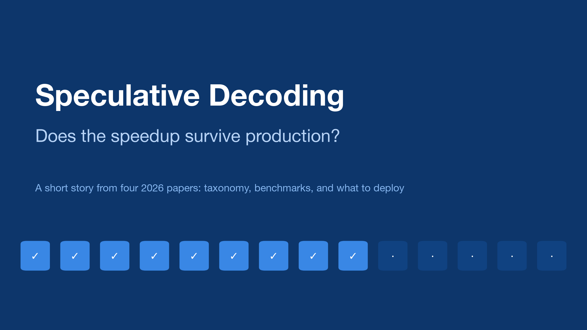
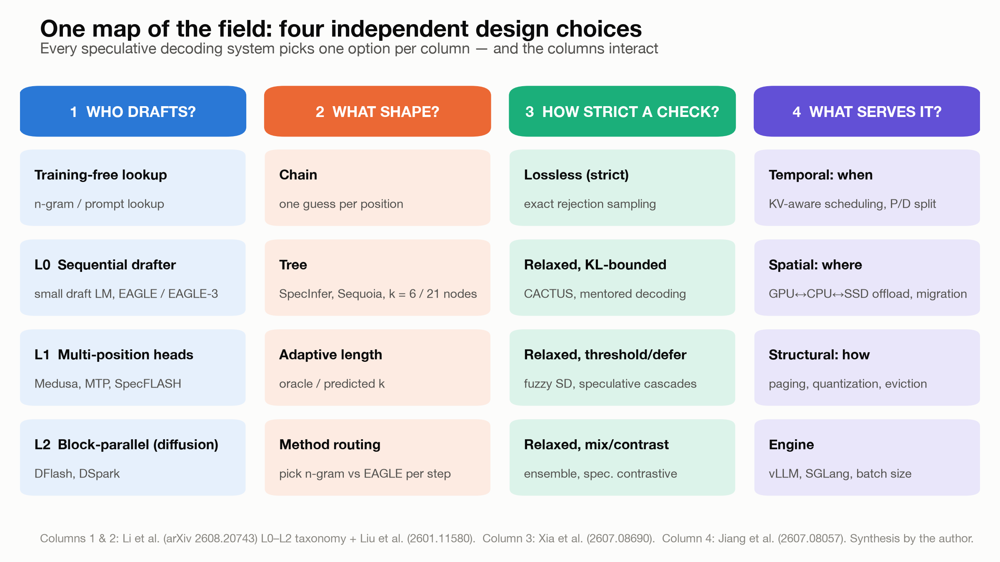
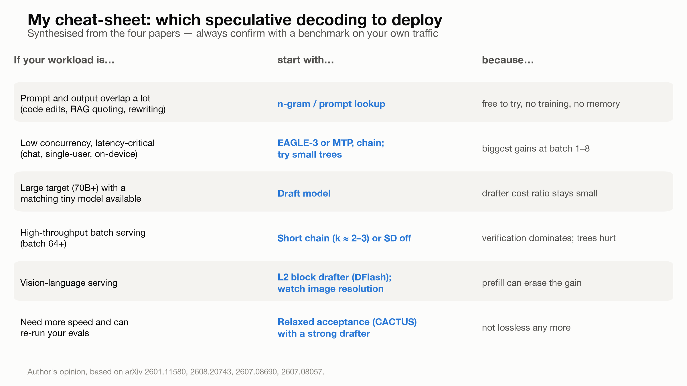

# Speculative Decoding: Does the Speedup Survive Production?

**A "short story" on LLM inference acceleration, built from four 2026 papers (surveys and systematic benchmarks)**



Speculative decoding is a widely used way to make LLMs generate text faster: a cheap *drafter* guesses several tokens, and the large model verifies them all in a single forward pass, with no change to output quality. This project asks whether that speedup holds up inside real serving systems. It combines a production benchmark of speculative decoding, a new survey of drafter designs, a study of relaxed verification, and a survey of the KV-cache serving layer underneath.

---

## Submission links

| Deliverable | Link |
|---|---|
| Medium article | [Speculative Decoding: Does the Speedup Survive Production?](https://medium.com/@akshatamadavi/speculative-decoding-does-the-speedup-survive-production-53517fe351f4) |
| SlideShare deck | `<add SlideShare URL after uploading>` |
| YouTube video (≥ 15 min) | `<add YouTube URL after uploading>` |
| GitHub repository | https://github.com/Akshata4/speculative-decoding-short-story |
| Class submission spreadsheet | [Google Sheet](https://docs.google.com/spreadsheets/d/13YnPKykntSONmfqkHyh94d7KsIvjdhrkblqKg8yLTFM/edit?gid=141293072#gid=141293072) |

---

## Papers covered

| # | Paper | Authors / affiliation | Date | Type |
|---|---|---|---|---|
| 1 | [Speculative Decoding: Performance or Illusion?](https://arxiv.org/abs/2601.11580) | Liu, Yu, Park, **Stoica**, Cheung · UC Berkeley | Dec 2025 / v2 Mar 2026 | Systematic benchmark in vLLM (**anchor paper**) |
| 2 | [Is Multimodal Speculative Decoding Ready for Diffusion-Based Parallel Drafting? A Survey and Empirical Diagnosis](https://arxiv.org/abs/2608.20743) | Li et al. · Nanjing University & China Unicom | Aug 2026 | **Survey** + benchmark |
| 3 | [A Practical Investigation of Training-free Relaxed Speculative Decoding](https://arxiv.org/abs/2607.08690) | Xia, Ribar, Balanca · Imperial College London / Graphcore | Jul 2026 | Taxonomy + benchmark |
| 4 | [Towards Efficient LLM Serving: A Survey on System-Aware KV Cache Optimization](https://arxiv.org/abs/2607.08057) | Jiang, Yang, Zhang, Liu · Univ. of Melbourne / HUST | Jul 2026 (ACL Findings 2026) | **Survey** |

Detailed reading notes for each paper are in [`papers/paper-notes.md`](papers/paper-notes.md).

---

## The story in one picture: a unified taxonomy



Every speculative decoding system makes four choices:

1. **Who drafts?**
   - n-gram lookup
   - **L0** sequential drafters (draft LMs, EAGLE)
   - **L1** multi-position heads (Medusa, MTP)
   - **L2** block-parallel diffusion drafters (DFlash, DSpark)
2. **What shape?** Chain, tree, adaptive length, or routing between methods.
3. **How strict is the check?** Lossless, or relaxed (KL-bounded, threshold/defer, mix/contrast).
4. **What serves it?** The KV cache: temporal scheduling, spatial placement, structural compression and eviction.

## Key findings

| Finding | Number | Source |
|---|---|---|
| Speedup decays with batch size | EAGLE 1.73× → 1.21× (batch 1 → 128) | Paper 1 |
| Verification dominates runtime | 42–95% of execution time; n-gram drafting < 2% | Paper 1 |
| Trees only help at low load | k=21 tree: 1.85× at batch 1, **< 1×** at batch 64 | Paper 1 |
| The simplest drafter can win | n-gram 7.27 vs EAGLE 4.24 accepted tokens on code editing | Paper 1 |
| Large headroom remains | Oracle draft length 2.75× vs 2.1× best fixed | Paper 1 |
| Diffusion drafters lead on multimodal | DFlash 2.60× vs EAGLE-3 1.69× on Qwen3.6-27B | Paper 2 |
| High-res images erase the gain | 8K images: 0.83–0.99× | Paper 2 |
| Relaxed checks double acceptance | 8.15 → 14.95 tokens/step (CACTUS), but quality must be re-tested | Paper 3 |
| Draft models cost KV memory | 144 → 256 KiB per token (Qwen3-8B) | Paper 1 + Paper 4 context |



---

## Repository contents

```
.
├── README.md                     ← you are here
├── article/
│   └── medium-article.md         ← full Medium article (original writing, ~3,500 words)
├── slides/
│   ├── speculative-decoding-deck.pdf    ← upload this to SlideShare
│   ├── speculative-decoding-deck.pptx   ← same deck, with speaker notes
│   └── png/                              ← one PNG per slide (23 slides)
├── video/
│   ├── script.md                         ← narration script, one section per slide (~3,100 words)
│   └── speculative-decoding-narrated-draft.mp4   ← 20.5-min narrated draft (TTS)
├── figures/                      ← 13 charts and diagrams used in the article and slides
├── papers/
│   └── paper-notes.md            ← structured notes: taxonomy, setup, numbers, ablations
├── scripts/
│   ├── make_figures.py           ← regenerates every figure from reported numbers
│   ├── make_slides.py            ← builds the PDF + PPTX deck
│   └── make_video.sh             ← builds the narrated video (macOS `say` + ffmpeg)
└── requirements.txt
```

### Figures

| File | What it shows |
|---|---|
| `f01_draft_verify.png` | How draft-then-verify works |
| `f02_speedup_formula.png` | Expected speedup vs draft length for different acceptance rates and drafter costs |
| `f03_taxonomy.png` | Unified four-column taxonomy |
| `f04_batch_decay.png` | Speedup vs batch size in vLLM |
| `f05_time_breakdown.png` | Where execution time goes |
| `f06_tree_vs_chain.png` | Tree vs chain verification |
| `f07_ngram_oracle.png` | n-gram vs EAGLE on code editing; oracle headroom |
| `f08_multimodal.png` | L0 / L1 / L2 drafters on vision-language models |
| `f09_mm_bottleneck.png` | Vision prefill cost and the high-resolution penalty |
| `f10_relaxed.png` | Strict vs relaxed acceptance |
| `f11_kv_taxonomy.png` | KV-cache serving taxonomy |
| `f12_decision_guide.png` | Deployment cheat-sheet (author's opinion) |

All charts are **drawn by the author from numbers reported in the papers**. No figures are copied from the papers.

---

## Reproduce everything

```bash
python3 -m venv .venv && source .venv/bin/activate
pip install -r requirements.txt
python scripts/make_figures.py      # → figures/*.png
python scripts/make_slides.py       # → slides/*.pdf, *.pptx, png/
bash scripts/make_video.sh          # → video/*.mp4   (macOS; needs ffmpeg)
```

To try the original experiments, the Berkeley team's simulator (paper 1) replays pre-profiled acceptance traces on a laptop in ~30–40 minutes: <https://github.com/SpecDecode-Bench/simulator>. The relaxed-SD reproduction code (paper 3) is at <https://github.com/graphcore-research/relaxed-spec-dec-repro>.

---

## How to publish (checklist)

- [ ] **Medium:** create a new story, paste the sections of `article/medium-article.md`, and upload the images from `figures/` where each `![...]` placeholder appears. Add tags such as *LLM, Machine Learning, AI Engineering, Inference, Speculative Decoding*. Paste the URL above.
- [ ] **SlideShare:** upload `slides/speculative-decoding-deck.pdf`. Paste the URL above.
- [ ] **Video:** record yourself presenting the PDF with `video/script.md` as speaker notes (target 15–18 min). Upload it to YouTube and add the `.mp4` to `video/`. The TTS draft is included as a timing reference and fallback.
- [ ] **Spreadsheet:** add the GitHub, Medium, SlideShare and YouTube links.

---

## References

1. X. Liu, J. Yu, J. Park, I. Stoica, A. Cheung. *Speculative Decoding: Performance or Illusion?* arXiv:2601.11580, 2026.
2. Y. Li et al. *Is Multimodal Speculative Decoding Ready for Diffusion-Based Parallel Drafting? A Survey and Empirical Diagnosis.* arXiv:2608.20743, 2026.
3. G. Xia, L. Ribar, P. Balanca. *A Practical Investigation of Training-free Relaxed Speculative Decoding.* arXiv:2607.08690, 2026.
4. J. Jiang, P. Yang, R. Zhang, F. Liu. *Towards Efficient Large Language Model Serving: A Survey on System-Aware KV Cache Optimization.* Findings of ACL 2026. arXiv:2607.08057.
5. Y. Leviathan, M. Kalman, Y. Matias. *Fast Inference from Transformers via Speculative Decoding.* ICML 2023.
