# Speculative Decoding: Does the Speedup Survive Production?

### What four 2026 papers show about a popular LLM speed trick: how the methods fit together, where the speedups go, and what I would actually deploy

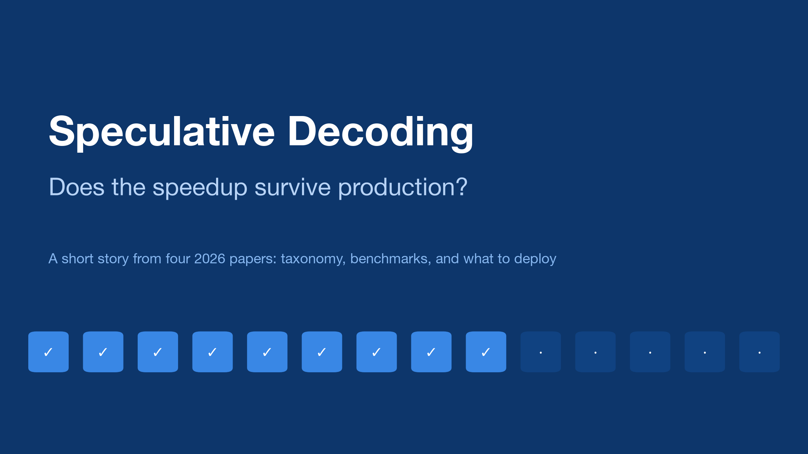

---

If you serve large language models, someone has probably told you to "turn on speculative decoding" for a free 2–3× speedup. The idea is elegant: let a small, cheap model guess the next few tokens, and let the big model check all of those guesses in one go. When the guesses are good you get several tokens for the price of one big-model step, and the output is mathematically identical to what the big model would have produced on its own.

The catch, which most blog posts skip, is that almost all of those headline numbers come from research prototypes running **one request at a time**. Real servers don't work like that. They batch dozens or hundreds of requests together, use paged KV caches, CUDA graphs and chunked prefill, and increasingly serve images and long reasoning traces as well as chat.

This article is a "short story" built from four papers released in 2026 that, read together, answer one question: **when you move speculative decoding into a real serving stack, how much of the speedup is performance and how much is illusion?**

| # | Paper | Type | Why it's here |
|---|---|---|---|
| 1 | **Speculative Decoding: Performance or Illusion?** Liu, Yu, Park, Stoica, Cheung (UC Berkeley), arXiv 2601.11580 | Systematic benchmark on vLLM | The anchor: first careful study inside a production engine |
| 2 | **Is Multimodal Speculative Decoding Ready for Diffusion-Based Parallel Drafting? A Survey and Empirical Diagnosis.** Li et al. (Nanjing University & China Unicom), arXiv 2608.20743 | Survey + benchmark | The newest taxonomy of *drafters* (L0/L1/L2) and the multimodal frontier |
| 3 | **A Practical Investigation of Training-free Relaxed Speculative Decoding.** Xia, Ribar, Balanca (Imperial College London / Graphcore), arXiv 2607.08690 | Taxonomy + benchmark | What happens when you relax the "exactly lossless" rule |
| 4 | **Towards Efficient LLM Serving: A Survey on System-Aware KV Cache Optimization.** Jiang, Yang, Zhang, Liu (Univ. of Melbourne / HUST), arXiv 2607.08057, ACL Findings 2026 | Survey | The serving-system layer every speedup sits on |

I'll keep the maths light and focus on the architecture, the experiments and ablations, the metrics, and my own take.

---

## 1. Thirty-second refresher: draft, then verify

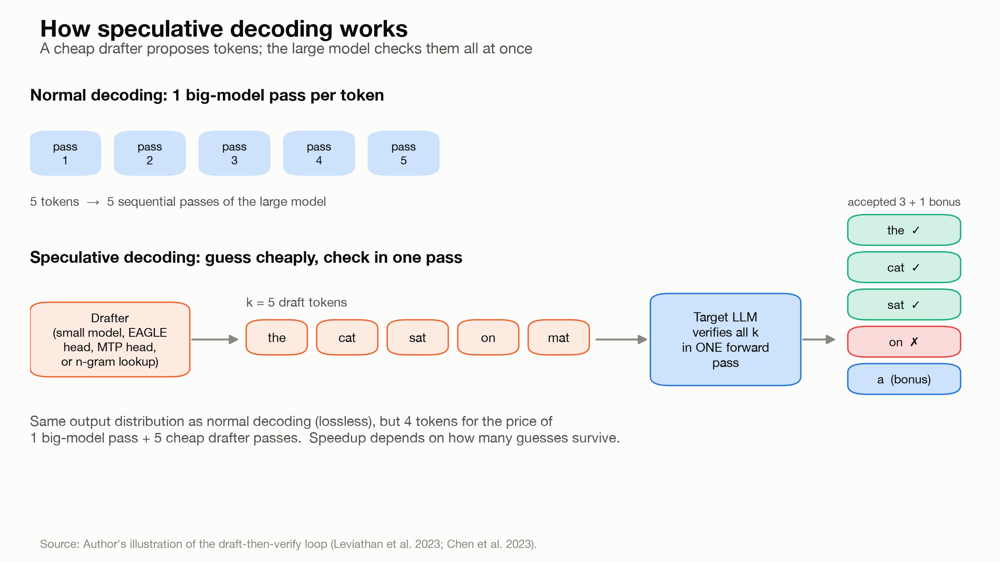

A normal LLM generates text **one token per forward pass**. On a modern GPU, a forward pass of a 70B model is dominated by reading the weights from memory. The arithmetic units sit mostly idle, so checking 5 tokens costs about the same as producing 1.

Speculative decoding exploits that idle compute:

1. A **drafter** proposes *k* tokens. It can be a small model, a light head bolted onto the big model, or even a simple text lookup.
2. The **target model** scores all *k* positions in **one** forward pass.
3. A rejection-sampling rule accepts the longest prefix of guesses that agrees with the target's distribution, then adds one "bonus" token from the target itself.

Because of how step 3 is built, the output distribution is *exactly* the target's. That's why the technique is called **lossless**, and why it became so popular: it's one of the very few speedups that doesn't trade away any quality.

### The one equation worth knowing

The Berkeley paper writes the expected speedup as:

> **E[speedup] = (1 − α^(k+1)) / ((1 − α)(k·c + 1))**

- **α**: how often each guess is accepted
- **k**: how many tokens you draft per step
- **c**: the cost of the drafter relative to one pass of the target

I plotted it to show why the speedup is so fragile:

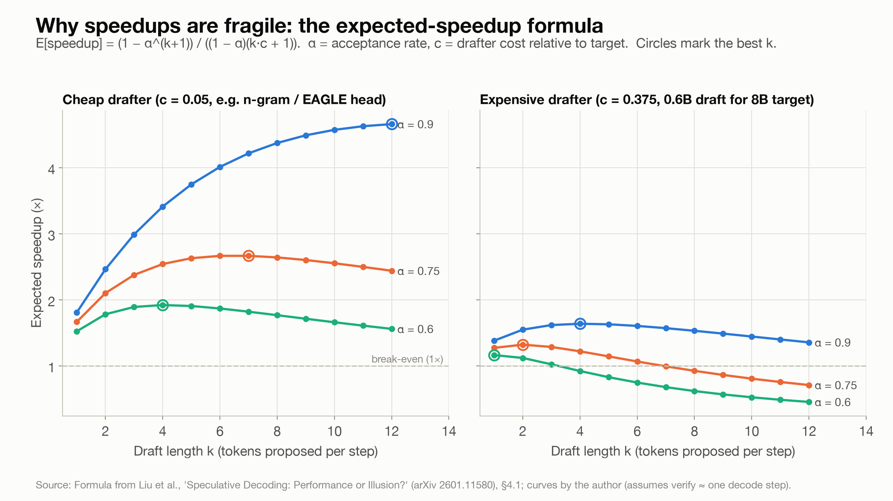

Two things jump out:

- With a cheap drafter and high acceptance (left, blue), drafting longer keeps paying, and 4×+ is possible on paper.
- Make the drafter expensive (right, c = 0.375, which is roughly what the Berkeley team measured for a 0.6B drafter serving an 8B target), and a moderately good drafter (α = 0.6) barely breaks even. Draft too far and you're **slower** than not speculating at all.

Keep this picture in mind: everything the four papers measure is really a story about **α, k and c moving around** when real workloads and real servers get involved.

---

## 2. One map of the field

Each paper brings its own taxonomy. Read separately they look unrelated, but they're really four independent design choices that every speculative decoding system has to make. Here's my combined map:

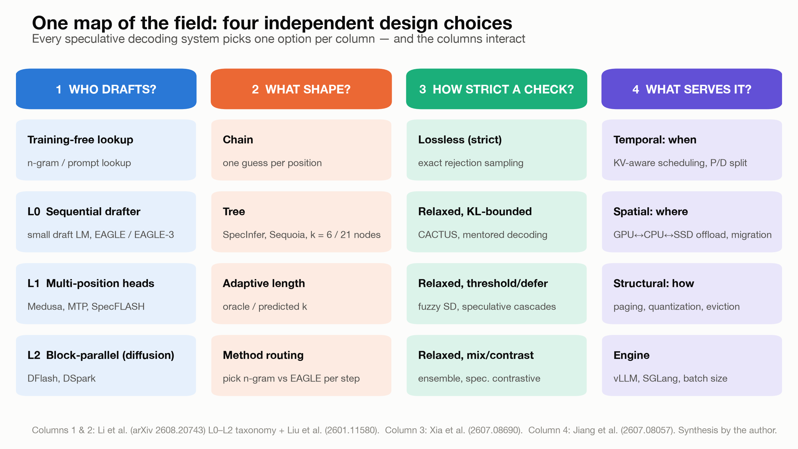

### Column 1: Who drafts? (from the multimodal survey, 2608.20743)

The multimodal survey gives the cleanest new vocabulary I've seen. It sorts drafters by **how much parallelism happens on the drafter side**:

- **L0 (sequential drafting).** One drafter step produces one draft token. Classic small draft models and the EAGLE family live here. They're accurate, but drafting k tokens costs k sequential steps.
- **L1 (multi-position parallel drafting).** Several heads predict offsets +1, +2, +3 … from the same hidden state in one shot. Examples are Medusa and **MTP (multi-token prediction)** heads, which models such as DeepSeek-V3, GLM-4.5 and Qwen3.5 now ship with. They're fast, but later positions are guessed "blind", without seeing the earlier guesses.
- **L2 (block-parallel generative drafting).** The drafter generates or refines a *whole block jointly*, usually with a small **diffusion** model. Examples are **DFlash** and **DSpark**. This is the newest family and, as we'll see, the current leaderboard leader.

There's also an older, training-free option that sits outside this ladder: **n-gram / prompt lookup**, which simply searches the existing context for the current suffix and copies what came next. It's free, it uses no GPU, and it's surprisingly strong in the right workload.

### Column 2: What shape are the guesses?

A **chain** proposes one token per position. A **tree** proposes several alternatives per position (SpecInfer, Sequoia), so even if guess #1 fails, guess #2 might survive. Newer ideas add **adaptive draft length** (predicting the right k at each step) and **method routing** (picking n-gram vs EAGLE per step).

### Column 3: How strict is the check? (from the relaxed SD paper, 2607.08690)

The Graphcore/Imperial paper puts all *training-free* relaxations into one framework. Each method swaps the target distribution for a "relaxed" one at three points: the accept/reject test, the resampling after a rejection, and the bonus token. Their groupings:

- **KL-bounded:** CACTUS, mentored decoding. They accept as much as possible while staying within a divergence budget of the target.
- **Threshold / defer:** fuzzy speculative decoding and speculative cascades. They accept when the two models are "close enough", or defer to the big model only when needed.
- **Mix / contrast:** ensembles of drafter and target, and speculative contrastive decoding, which is the only one that tries to make the model *better* rather than faster.

### Column 4: What serves it? (from the KV-cache survey, 2607.08057)

Underneath everything is the serving engine and its KV cache. The Melbourne survey organises "system-aware KV infrastructure" along three axes:

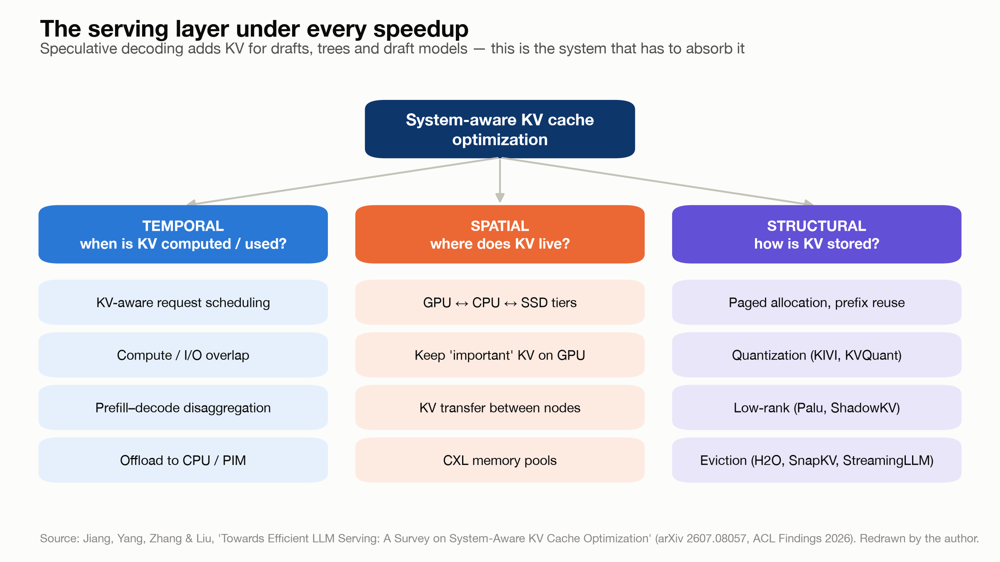

- **Temporal (when):** KV-aware request scheduling, overlapping compute with I/O, prefill–decode disaggregation.
- **Spatial (where):** moving KV between GPU, CPU, SSD and remote nodes; keeping the "important" entries on the GPU.
- **Structural (how):** paged allocation and prefix reuse, quantization (KIVI, KVQuant), low-rank compression (Palu, ShadowKV), and eviction (H2O, SnapKV, StreamingLLM).

The survey never mentions speculative decoding by name, and I think that's a gap. Every draft token, every tree branch and every separate draft model **adds KV cache that this layer has to absorb**. The Berkeley paper measured it: a separate draft model raises per-token KV memory on Qwen3-8B from 144 KiB to 256 KiB (1.77×). EAGLE-3 adds only ~5% static memory, and n-gram adds nothing.

---

## 3. The reality check: speculative decoding inside vLLM

The Berkeley paper is the heart of this story. The authors (from Ion Stoica's group at Berkeley, the lab ecosystem behind vLLM, Spark and Ray) ran every major variant inside **vLLM** with all production optimizations switched on.

**The setup in one paragraph:**

| Setting | Details |
|---|---|
| Hardware | H100 80 GB GPUs; 4-way tensor parallel for the 70B and 106B models |
| Models | Llama3.1-8B, Llama3-70B, Qwen3-8B (with and without "thinking"), GLM-4.5-Air (106B MoE) |
| Drafters | n-gram, EAGLE, EAGLE-3, draft models, MTP |
| Workloads | CNN/DailyMail, ShareGPT, InstructCoder, GSM8K, AIME and GPQA |
| Batch sizes | 1 to 128 |
| Metric | Token throughput rather than per-request latency, because output length varies between runs |

### Finding 1: the speedup shrinks as the server gets busy

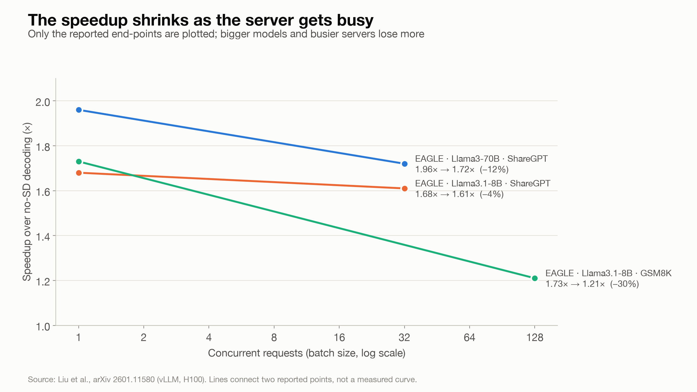

EAGLE on Llama3.1-8B / GSM8K gives **1.73× at batch 1 but only 1.21× at batch 128**. The drop is worse for bigger models: on ShareGPT the 70B model loses 14% of its speedup by batch 32, while the 8B loses only 4%.

The reason follows from the refresher. Speculative decoding spends *spare compute*. At batch 1 the GPU is starved for work, so verifying 4 extra tokens is nearly free. At batch 128 the GPU is already busy, and every speculative token you verify takes compute away from a real request.

### Finding 2: verification, not drafting, is the bottleneck

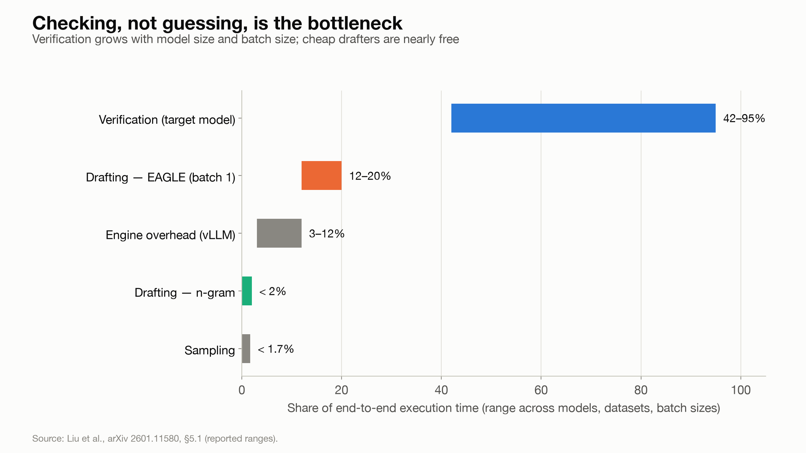

This was the most surprising result for me. Research effort mostly goes into **better drafters**, but the profile shows the target model's verification pass takes **42–95% of total time**. n-gram drafting costs less than 2%, and even EAGLE drafting is only 12–20% at batch 1. Sampling is below 2%, and vLLM's own scheduling overhead is 3–12%.

In other words, a perfect, zero-cost drafter would barely change things at high batch sizes. **What hurts is verifying tokens that get rejected.**

### Finding 3: trees are a batch-1 trick

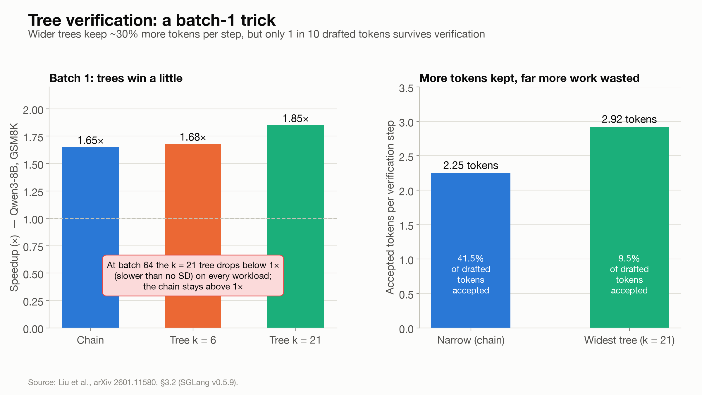

Tree verification (tested in SGLang) does help at batch 1: on Qwen3-8B / GSM8K a 21-node tree reaches 1.85× vs 1.65× for a chain. But look at the right panel. The wide tree keeps ~30% more tokens per step while its acceptance rate falls from 41.5% to **9.5%**, so nine in ten verified tokens are thrown away. At batch 64 that waste can't hide in idle compute any more, and **the 21-node tree is slower than not speculating at all, on every workload**. The plain chain stays above 1×.

### Finding 4: no drafter wins everywhere, and the "dumb" one sometimes does

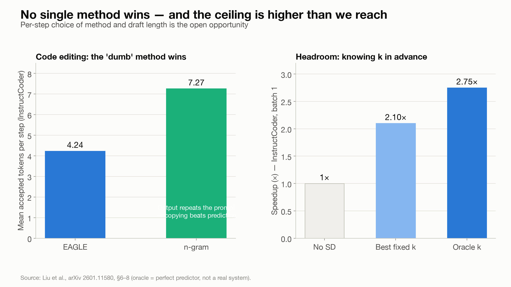

On **InstructCoder** (code editing), the output repeats large parts of the input. The free n-gram lookup accepts **7.27 tokens per step on average versus 4.24 for EAGLE**, and beats both EAGLE variants on the 8B models. The authors show that n-gram's advantage grows with the prompt–output overlap (measured as BLEU-4). Above about 0.6 overlap it wins at every batch size, by up to 53% with k = 3 and up to 100% with k = 5.

Acceptance is also very uneven *within* a single request. n-gram is "bursty", with occasional runs of 15+ accepted tokens followed by long stretches of nothing. EAGLE is steadier, with a median of 2–4.

Other method comparisons worth noting:

- **Draft models** are best for the 70B target (the drafter is only ~12.5% of a target pass) and worst for Qwen3-8B, where the drafter costs ~37.5% of a target pass. That's the c term from our equation again.
- **On reasoning models** (Qwen3-8B "thinking" on AIME and GPQA), EAGLE-3 gives 1.64–1.80× and n-gram 1.50–1.58×. These are long outputs where speculative decoding works well.
- **MTP on GLM-4.5-Air** reaches only 1.3–1.8×. The released MTP head is trained mainly for the *first* future token, so per-position acceptance decays from 0.92 to 0.68 to 0.38 when it is reused for positions 2 and 3.

### Finding 5: the ceiling is much higher than what we reach

The authors then ask: *what if we knew the right answer ahead of time?*

- An **oracle draft length** (always propose exactly as many tokens as will be accepted) reaches ~2.75× on InstructCoder at batch 1, against ~2.1× for the best *fixed* k.
- An **oracle that picks n-gram or EAGLE at every position** gives up to 2.2× more on top of the best single fixed strategy.

These are upper bounds, not real systems, but they show where the next gains are: **adaptive, per-step decisions** about how much to draft and which drafter to trust.

### A note on nondeterminism

One small but useful ablation: even with greedy decoding (temperature 0), output lengths differed across batch sizes and SD variants. The authors trace this to floating-point nondeterminism in GPU kernels, not bugs. If you benchmark speculative decoding yourself, measure **throughput**, not "time to generate this exact answer", because the answer itself can change.

---

## 4. The frontier: multimodal models and diffusion drafters

The multimodal survey (2608.20743) is two papers in one. The first half is a broad survey of speculative decoding across:

- **Vision-language models (VLMs):** reusing or pruning visual tokens for the drafter (MASSV, ViSpec, SpecVLM, DREAM).
- **Video models:** sparse attention in the drafter, pipelining.
- **Vision-language-action models (robots, self-driving):** relaxed acceptance, because a slightly different steering angle is often fine (Spec-VLA, KERV).
- **Speech:** ASR and TTS with tolerance-based acceptance.
- **Autoregressive image generation:** relaxed latent acceptance (LANTERN), speculative Jacobi decoding.

The second half is an empirical "readiness check" on Qwen3-VL and Qwen3.6 models across six VLM tasks (GQA, Flickr30K, TextVQA, CharXiv, MMMU, ConvBench).

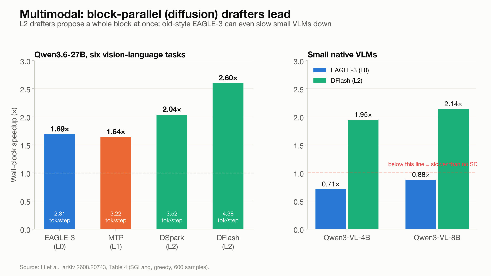

The leaderboard is clear:

| Drafter | Level | Accepted tokens / step | Speedup on Qwen3.6-27B |
|---|---|---|---|
| EAGLE-3 | L0 | 2.31 | 1.69× |
| MTP | L1 | 3.22 | 1.64× |
| DSpark | L2 | 3.52 | 2.04× |
| **DFlash** | **L2** | **4.38** | **2.60×** |

The L2 diffusion drafter **DFlash wins on every task**. On the smaller native VLMs the gap is dramatic: EAGLE-3 is actually *slower* than plain decoding (0.71× on the 4B model, 0.88× on the 8B), while DFlash gets 1.95–2.14×.

### Why only "partially ready"

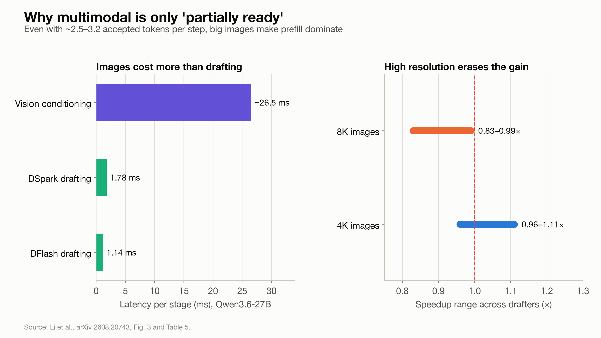

Two diagnostics temper the excitement:

- **Images cost more than drafting.** Encoding and conditioning on the image takes ~26–27 ms per request, while drafting a whole block takes only 1–2 ms. The image prefill dominates.
- **High resolution erases the gain.** On HR-Bench at 4K resolution the speedup is 0.96–1.11×. At 8K it falls to 0.83–0.99×, *slower* than not speculating, even though acceptance stays healthy at 2.5–3.2 tokens per step.

An ablation I liked: hiding the visual KV entries from the drafter lowers acceptance by only ~4%, while removing the whole prefill context lowers it by 11–14%. The drafter leans on the *text* context far more than on the pixels, which suggests compressing the visual input to the drafter is cheap to do.

The authors are also honest about confounds. Model size, drafter checkpoint, training recipe and serving backend all vary together, so you can't credit any single factor. Framework support for multimodal L2 drafters is also still immature.

---

## 5. Should we stop being lossless?

The relaxed SD paper (2607.08690) asks a provocative question: the standard method is lossless, but what if we accept tokens that are merely *close enough*?

**Setup:**

| Setting | Details |
|---|---|
| Drafter–target pairs | A strong drafter (Qwen3 8B → 32B), a weak drafter (Qwen3 0.6B → 32B), a built-in MTP head (Qwen3.5 → 27B), and Llama 3.2 1B → 3.1 70B |
| Tasks | Hard reasoning in "thinking" mode: AIME 2024, GPQA Diamond, LiveCodeBench |
| Sweeps | Draft lengths 3, 5, 10, 20; several drafter-cost ratios; ~1,000 queries per point to beat the noise |

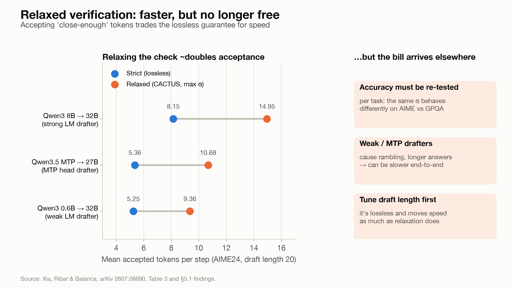

**The upside is real.** With CACTUS at draft length 20, mean accepted tokens per step roughly doubles: 8.15 → 14.95 for the strong drafter, 5.36 → 10.68 for the MTP drafter, and 5.25 → 9.36 for the weak drafter.

**The bill arrives elsewhere:**

1. **You lose the free lunch on quality.** Strict SD never needs re-evaluation, but relaxed SD does, *per task*. The same relaxation strength α gives very different trade-offs on AIME and GPQA, so you can't tune it once and forget it.
2. **Weak and MTP drafters make models ramble.** Accepting more of a weak drafter's tokens can make answers *longer* and more repetitive, which can make the whole response slower even while tokens per second go up.
3. **Many methods assume the drafter is itself a good language model.** That conflicts with where the industry is heading: lightweight MTP heads. Only the KL-bounded methods (CACTUS and mentored decoding) stayed useful with MTP drafters.
4. **Tune draft length first.** Simply changing k moved the speedup about as much as relaxation did, and it is lossless.

The paper also points out a practical engineering issue. In stock vLLM, a 0.6B drafter's relative cost jumped from 0.27 in its own decode mode to **0.85** inside the speculative decoding loop, so implementation overhead can wipe out a theoretically cheap drafter. The authors released their code at `graphcore-research/relaxed-spec-dec-repro`.

---

## 6. Putting it together: what I would actually deploy

Here's my synthesis of the four papers into a practical cheat-sheet:

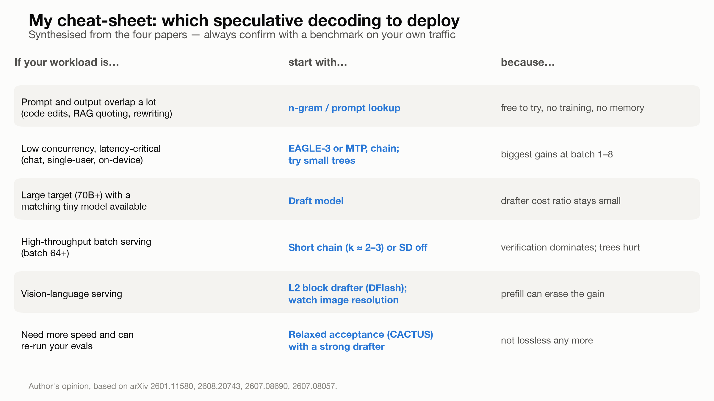

And the reasoning behind it:

- **Measure your batch size before anything else.** It's the single biggest predictor of whether speculative decoding helps. Below ~8 concurrent requests it's almost always worth it; above ~64, keep chains short or switch it off.
- **Try n-gram first if your outputs echo your inputs.** That covers code editing, RAG answers that quote sources, and document rewriting. It costs nothing and sometimes beats trained drafters.
- **Treat trees as a latency feature, not a throughput feature.**
- **For VLMs, look at L2 drafters, but profile the image prefill first.** If your images are high resolution, speculative decoding may not be your bottleneck at all.
- **Stay lossless unless you own the eval pipeline.** Relaxed acceptance is a product decision, not an inference flag.
- **Budget the KV cache.** Draft models nearly double per-token KV for small targets. That memory comes out of your batch size, which in turn shrinks your speedup.

---

## 7. My two cents

**What these papers get right.** The Berkeley paper does something the field badly needed: it measures inside the engine people actually deploy, at the batch sizes people actually run. The finding that verification dominates should redirect research from "better guessers" to "**cheaper or smarter checking**": verifying only the tokens likely to be accepted, or predicting k per step. Similarly, the relaxed SD paper's habit of reporting *end-to-end* speedup, including longer answers, is a model for honest benchmarking.

**Where I'm skeptical.**

- The oracle numbers (2.75×, "up to 2.2× more") are upper bounds that assume perfect foresight. A real predictor will make mistakes, and its own cost has to fit inside a 1–2 ms budget per step. I'd like to see a learned router evaluated end-to-end before treating those gains as reachable.
- The multimodal benchmark changes model, drafter checkpoint and backend at the same time, which the authors acknowledge. The DFlash-vs-EAGLE-3 gap is large enough that I believe the direction, but not the exact size.
- The relaxed SD speedups are mostly *modelled* rather than measured end-to-end. Given that the same paper shows vLLM overheads can triple a drafter's cost, I'd want wall-clock numbers before relying on them.
- The KV-cache survey is excellent on its own terms, but it treats speculative decoding as out of scope. In practice, KV-aware schedulers that *know* about speculative tokens (pausing, resuming, and evicting draft KV) look like an obvious, under-explored combination. The Berkeley paper flags exactly this as future work for EAGLE heads.

**What I'll be watching.** Three trends point the same way: diffusion-style block drafters (L2), adaptive per-step routing, and verification-aware schedulers. The next generation of speculative decoding will probably not be "one drafter, fixed k, always on", but a **runtime policy** that decides, every step and for every request, whether to speculate, with what, and how far. The papers in this story give us the measurements needed to build that policy.

---

## References

1. X. Liu, J. Yu, J. Park, I. Stoica, A. Cheung. *Speculative Decoding: Performance or Illusion?* arXiv:2601.11580 (v2, Mar 2026). Code: github.com/SpecDecode-Bench
2. Y. Li, H. Gao, F. Zhao, et al. *Is Multimodal Speculative Decoding Ready for Diffusion-Based Parallel Drafting? A Survey and Empirical Diagnosis.* arXiv:2608.20743 (Aug 2026).
3. G. Xia, L. Ribar, P. Balanca. *A Practical Investigation of Training-free Relaxed Speculative Decoding.* arXiv:2607.08690 (Jul 2026). Code: github.com/graphcore-research/relaxed-spec-dec-repro
4. J. Jiang, P. Yang, R. Zhang, F. Liu. *Towards Efficient Large Language Model Serving: A Survey on System-Aware KV Cache Optimization.* arXiv:2607.08057, Findings of ACL 2026.
5. Background: Y. Leviathan, M. Kalman, Y. Matias. *Fast Inference from Transformers via Speculative Decoding.* ICML 2023; C. Chen et al. *Accelerating Large Language Model Decoding with Speculative Sampling.* 2023.

*All charts in this article were drawn by the author from numbers reported in the papers above (see the source line under each chart). The code to regenerate them is in the accompanying GitHub repository.*
